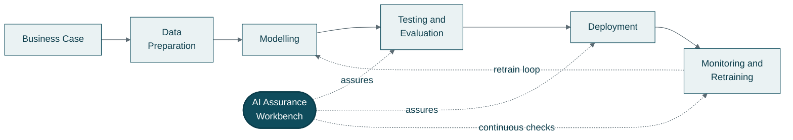
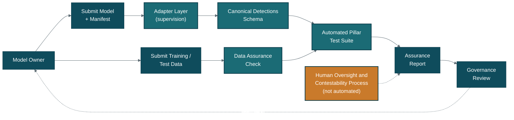

# AI Assurance Workbench

A modular framework and toolkit for testing, scoring, and documenting the trustworthiness of deployed AI and ML models, built to close the gap between AI governance standards, which define principles, and AI governance practice, which requires repeatable, automated testing.

## Where this fits in the AI lifecycle

Assurance is not a one-off gate before release. It applies at initial testing and evaluation, at deployment sign-off, and continuously during monitoring and retraining, since a model's behavior can drift after deployment.

## Why this exists

Vision and ML models are increasingly deployed in safety and quality critical industrial settings, but proving a model is safe, robust, fair, and explainable is still largely a manual, ad-hoc process. Dozens of open-source assurance tools exist (explainability libraries, adversarial robustness toolkits, fairness and drift checkers, model documentation generators), but each one is typically wired into a specific model's inputs and outputs by hand, on a case-by-case basis, and rarely traced back to a named regulatory or standards requirement.

This project standardizes that process: define a common model-submission schema, map recognized AI governance standards onto a consistent, standards-traceable set of testable dimensions, and automatically generate and run the right combination of tests for a given model, producing a scored, human-readable assurance report.

## Architecture

A model owner submits model weights plus a manifest (task type, framework, preprocessing, class list, explainability target layer), and separately points to the training/test data used. The adapter layer normalizes whatever framework the model is built on into one canonical detection schema, so every downstream test tool only ever needs to understand one data shape rather than each framework's native output. The workbench runs the relevant automated tests against that normalized output and against the submitted data, aggregates results into an assurance report alongside evidence from the (non-automated) human oversight and contestability process, and a governance reviewer signs off or sends feedback back to the model owner. Continuous drift monitoring runs independently of this pipeline against live production data, feeding the retrain loop shown in the lifecycle diagram above.

## Project journey

**Phase 1, completed:** applied existing assurance tools and techniques end to end to validate a real-world computer vision system deployed on edge hardware for manufacturing assembly verification. This involved:

- Reviewing an existing deployed model, its documentation, and its test dataset to plan a testing approach.
- Running an explainability analysis (SHAP) to confirm the model's decisions were based on the correct visual features rather than spurious correlations.
- Running an adversarial robustness assessment (Adversarial Robustness Toolbox) across multiple attack types and perturbation levels, covering both natural degradation and deliberate manipulation.
- Running a fairness and data-quality assessment (DeepChecks) across varying environmental conditions such as lighting, sharpness, exposure, and contrast.
- Producing standardized model documentation (Model Card Toolkit) covering capabilities, intended use, and known limitations.
- Consolidating all four assessments into an overall trustworthiness scorecard, mapped against a simplified set of trust pillars, with risk-based recommendations ahead of production deployment.

**Phase 2, current:** generalizing that manual, tool-by-tool process into a reusable framework and workbench, so any submitted model can be tested automatically against a standard set of trust dimensions rather than assembled by hand each time. This phase also re-derives the dimension set directly from primary sources — the EU AI Act, the NIST AI Risk Management Framework, and the ISO/IEC SC42 standards catalog — rather than reusing Phase 1's simplified pillar set, so that assurance evidence can be traced to a named regulatory or standards clause rather than an internal label alone.

*(All results and details above are generalized. No client, project, or quantitative specifics are included.)*

## Framework: dimensions of trustworthy AI

Model assurance is structured around a consistent set of dimensions, each independently testable and scoreable, and each traceable to a specific standard:

| Dimension | What it evaluates | Standard(s) | Example techniques |
|---|---|---|---|
| Transparency and explainability | Can predictions be understood and attributed to input features? | ISO/IEC TR 24028 | SHAP, LIME, Grad-CAM |
| Safety, security, and robustness | How does the model behave under noise, adversarial attack, or distribution shift? | ISO/IEC 24029, ISO/IEC 5469, IEC 61508 | Adversarial Robustness Toolbox (FGSM, PGD, Carlini and Wagner, patch and noise attacks) |
| Fairness and non-discrimination | Does performance hold consistently across sub-populations or environmental conditions? | ISO/IEC 24027 | DeepChecks, stratified evaluation |
| Data quality and representativeness | Is training/test data relevant, complete, accurate, and representative of the real deployment population? | ISO/IEC 5259 series, ISO/IEC 42001 Annex A | DeepChecks (data integrity checks) |
| Accountability and governance | Is the model's design, training data, and intended use properly documented? | ISO/IEC 42001 | Model Card Toolkit, standardized metadata schemas |
| Human oversight, contestability, and redress | Does a human retain final decision authority, and can affected stakeholders challenge or query a model's decision? | ISO/IEC TS 8200 | Structured audit and appeal workflows |
| Privacy and data governance | Is data access, storage, and handling properly governed? | EU AI Act (privacy and data governance) | *tool under evaluation* |
| Societal and environmental wellbeing | Broader societal/environmental impact of the deployment | EU AI Act | *scope decision pending for industrial inspection use cases* |

Each automatable dimension produces a score and a status flag; the two process-based dimensions (human oversight/contestability, and privacy/data governance) produce documented evidence rather than a score. All results roll up into an overall assurance scorecard for the model, stating for each governing framework whether it is currently met, partially met, or not met, with specific recommendations for closing any gap.

## Reference standards

The dimension framework above is designed to map onto, not replace, existing AI governance and safety standards:

- **EU AI Act** — binding EU regulation; risk-tiered (unacceptable / high-risk / limited-risk / minimal-risk), with high-risk systems (which can include safety components of industrial products) subject to technical documentation, risk management, conformity assessment, and human oversight obligations.
- **NIST AI Risk Management Framework (AI RMF)** — voluntary US framework, structured around four functions (Govern, Map, Measure, Manage) and a set of trustworthiness characteristics that the dimension table above draws on directly.
- **ISO/IEC 42001** — certifiable AI management system standard; the organizational-process layer behind the accountability and governance dimension.
- **ISO/IEC SC42 standards catalog** (the international standards body for AI), specifically:
  - ISO/IEC TR 24028 — overview of trustworthiness in AI (conceptual basis for the dimension set)
  - ISO/IEC 24027 — bias in AI systems and AI-aided decision making
  - ISO/IEC 24029 — robustness testing of neural networks
  - ISO/IEC 5259 series — data quality for analytics and machine learning
  - ISO/IEC 5469 — functional safety and AI systems
  - ISO/IEC TS 8200 — human oversight of AI systems
- **IEC 61508** — traditional functional safety standard for industrial systems; predates AI but still applies to safety-critical deployments.
- **AMLAS** (Assurance of Machine Learning for use in Autonomous Systems, University of York) — methodology for building a formal safety case/argument from ML test evidence, most relevant where model output feeds a safety-relevant decision.
- **IEEE 7000 series** — process standard for addressing ethical concerns during system design.
- **BSI PAS 1085** — manufacturing traceability standard; relevant where model outputs need to be traceable within a manufacturing digital thread.
- **ENISA AI security guidance** — EU cybersecurity agency guidance on securing AI pipelines.

## Architectural principles

- **Schema-driven, not tool-driven.** The model submission schema decouples what is being tested from how it is tested, so underlying test tools can be swapped or extended independently.
- **Framework-agnostic by design.** A single adapter layer (built around the `supervision` library) normalizes detection output from any supported framework into one canonical schema, so pillar tests are written once and reused across every model, regardless of the framework it was built on.
- **Dimension-based modularity.** Each trust dimension is an independent, pluggable module, allowing partial assurance runs and incremental adoption.
- **Standards-traced by design.** Every dimension is mapped to a specific, named standard or regulation, so results can be reported as framework-level compliance status, not just an internal score.
- **Human-in-the-loop reporting.** Automated testing feeds a report designed for review and sign-off by governance stakeholders, not a fully autonomous pass or fail gate. Dimensions that are inherently procedural (human oversight, contestability) are documented as workflows, not simulated as automated tests.
- **Extensible beyond a single model type.** Phase 1 targeted a vision model. The orchestration and reporting layers are designed to generalize to other modalities, such as language or tabular models, as new test modules are added.

## Roadmap

- [x] Map governance standards onto a simplified, testable pillar set (Phase 1)
- [x] Validate framework against a real-world industrial vision model
- [x] Modular audit pipeline (SHAP, ART, DeepChecks, Model Card Toolkit) as reusable notebooks
- [ ] Re-derive assurance dimensions directly from the EU AI Act, NIST AI RMF, and ISO/IEC SC42 (supersedes the Phase 1 pillar set)
- [ ] Model-submission schema decoupled from any specific tool or model architecture
- [ ] Framework-agnostic adapter layer (`supervision`) with per-framework converters and a canonical detection schema
- [ ] Automated test-plan generation from a submitted model schema
- [ ] Data assurance module for training/test data quality and representativeness
- [ ] Documented human oversight and contestability workflow
- [ ] Live results dashboard
- [ ] Auto-generated assurance reports with framework-level compliance status and improvement recommendations
- [ ] Generalize audit pipeline beyond vision models (for example, LLMs, tabular, or time-series models)

## Tech stack

Python, PyTorch, OpenCV, `supervision` (canonical detection schema and framework adapters), SHAP, Captum (Grad-CAM), Adversarial Robustness Toolbox (ART), DeepChecks, Model Card Toolkit, Alibi Detect (drift and out-of-distribution monitoring), Jupyter, MLflow

## Status

Active development. The core audit pipeline is functional and has been validated against a production use case. The unified workbench (schema-driven, framework-agnostic adapters, automated test orchestration, dashboard) is in progress.
