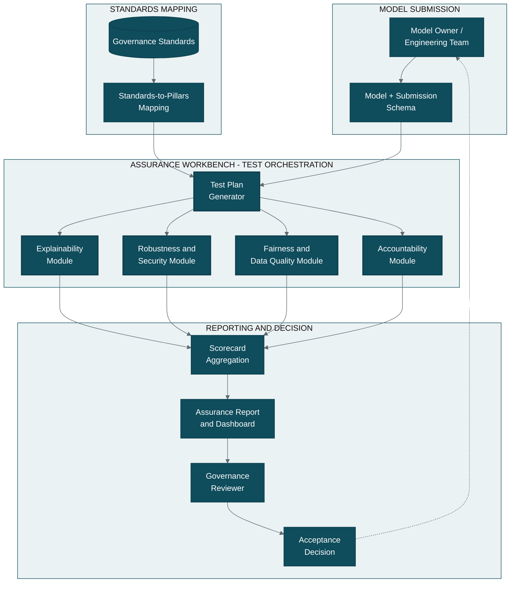
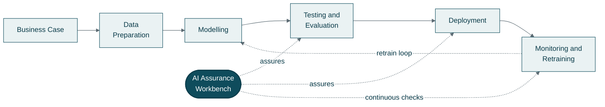

# AI Assurance Workbench

A modular framework and toolkit for testing, scoring, and documenting the trustworthiness of deployed AI and ML models, built to close the gap between AI governance standards, which define principles, and AI governance practice, which requires repeatable, automated testing.

## Why this exists

Vision and ML models are increasingly deployed in safety and quality critical industrial settings, but proving a model is safe, robust, fair, and explainable is still largely a manual, ad-hoc process. Dozens of open-source assurance tools exist (explainability libraries, adversarial robustness toolkits, fairness and drift checkers, model documentation generators), but each one is typically wired into a specific model's inputs and outputs by hand, on a case-by-case basis.

This project standardizes that process: define a common model-submission schema, map recognized AI governance standards onto a consistent set of testable pillars, and automatically generate and run the right combination of tests for a given model, producing a scored, human-readable assurance report.

## Project journey

**Phase 1, completed:** applied existing assurance tools and techniques end to end to validate a real-world computer vision system deployed on edge hardware for manufacturing assembly verification. This involved:

- Reviewing an existing deployed model, its documentation, and its test dataset to plan a testing approach.
- Running an explainability analysis (SHAP) to confirm the model's decisions were based on the correct visual features rather than spurious correlations.
- Running an adversarial robustness assessment (Adversarial Robustness Toolbox) across multiple attack types and perturbation levels, covering both natural degradation and deliberate manipulation.
- Running a fairness and data-quality assessment (DeepChecks) across varying environmental conditions such as lighting, sharpness, exposure, and contrast.
- Producing standardized model documentation (Model Card Toolkit) covering capabilities, intended use, and known limitations.
- Consolidating all four assessments into an overall trustworthiness scorecard, mapped against a standard set of AI trust pillars, with risk-based recommendations ahead of production deployment.

**Phase 2, current:** generalizing that manual, tool-by-tool process into a reusable framework and workbench, so any submitted model can be tested against a standard set of trust pillars automatically rather than assembled by hand each time.

*(All results and details above are generalized. No client, project, or quantitative specifics are included.)*

## Framework: pillars of trustworthy AI

Model assurance is structured around a consistent set of pillars, each independently testable and scoreable:

| Pillar | What it evaluates | Example techniques |
|---|---|---|
| Explainability and transparency | Can predictions be understood and attributed to input features? | SHAP, LIME, Grad-CAM |
| Safety, security, and robustness | How does the model behave under noise, adversarial attack, or distribution shift? | Adversarial Robustness Toolbox (FGSM, PGD, Carlini and Wagner, patch and noise attacks) |
| Fairness and data quality | Does performance hold consistently across sub-populations or environmental conditions? | DeepChecks, stratified evaluation |
| Accountability and governance | Is the model's design, training data, and intended use properly documented? | Model Card Toolkit, standardized metadata schemas |
| Contestability and redress | Can affected stakeholders challenge or query a model's decision? | Structured audit and appeal workflows |
| Deployment and scalability | Does the model meet latency, consistency, and operational requirements in production? | Latency benchmarking, MLOps monitoring |

Each pillar produces a score and a status flag, rolled up into an overall assurance scorecard for the model.

## Reference standards

The pillar framework is designed to map onto, not replace, existing AI governance and safety standards, including:

- NIST AI Risk Management Framework (AI RMF)
- ISO/IEC 42001 (AI management systems)
- EU AI Act
- AMLAS (Assurance of Machine Learning for use in Autonomous Systems)
- IEEE 7000 series
- BSI PAS 1085
- ISO/IEC TR 24028
- ENISA AI security guidance

## Where assurance plugs into the AI lifecycle

Assurance is not a one-off gate before release. It applies at initial testing and evaluation, at deployment sign-off, and continuously during monitoring and retraining, since a model's behavior can drift after deployment.

## Architectural principles

- **Schema-driven, not tool-driven.** The model submission schema decouples what is being tested from how it is tested, so underlying test tools can be swapped or extended independently.
- **Pillar-based modularity.** Each trust dimension is an independent, pluggable module, allowing partial assurance runs and incremental adoption.
- **Standards-aligned by design.** The standards-mapping layer translates recognized AI governance frameworks into concrete, automatable test criteria.
- **Human-in-the-loop reporting.** Automated testing feeds a report designed for review and sign-off by governance stakeholders, not a fully autonomous pass or fail gate.
- **Extensible beyond a single model type.** Phase 1 targeted a vision model. The orchestration and reporting layers are designed to generalize to other modalities, such as language or tabular models, as new test modules are added.

## Roadmap

- [x] Map governance standards onto testable pillars
- [x] Validate framework against a real-world industrial vision model
- [x] Modular audit pipeline (SHAP, ART, DeepChecks, Model Card Toolkit) as reusable notebooks
- [ ] Model-submission schema decoupled from any specific tool or model architecture
- [ ] Automated test-plan generation from a submitted model schema
- [ ] Live results dashboard
- [ ] Auto-generated assurance reports
- [ ] Generalize audit pipeline beyond vision models (for example, LLMs, tabular or time-series models)

## Tech stack

Python, PyTorch, OpenCV, SHAP, Adversarial Robustness Toolbox (ART), DeepChecks, Model Card Toolkit, Jupyter, MLflow

## Status

Active development. The core audit pipeline is functional and has been validated against a production use case. The unified workbench (schema-driven, automated test orchestration, dashboard) is in progress.

